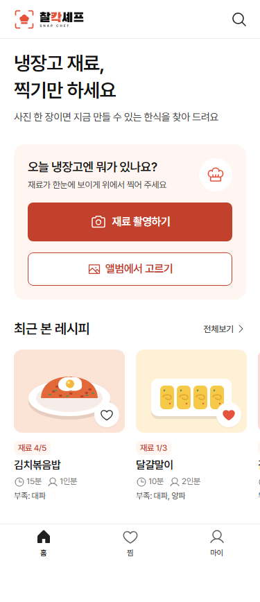
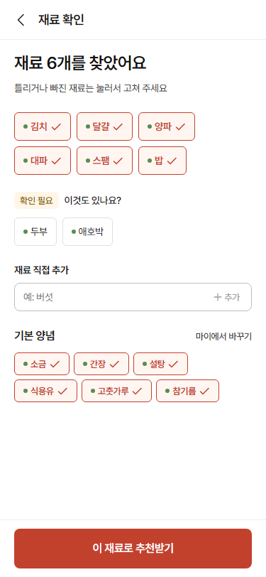
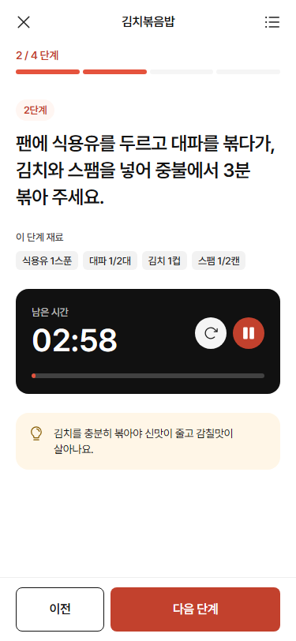
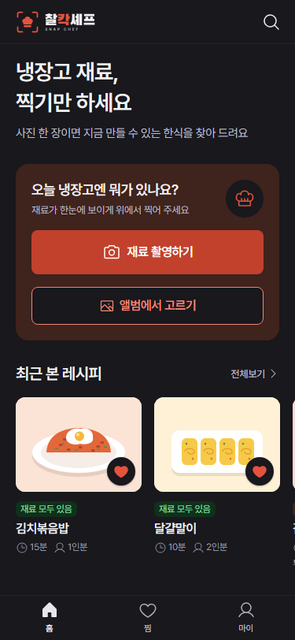
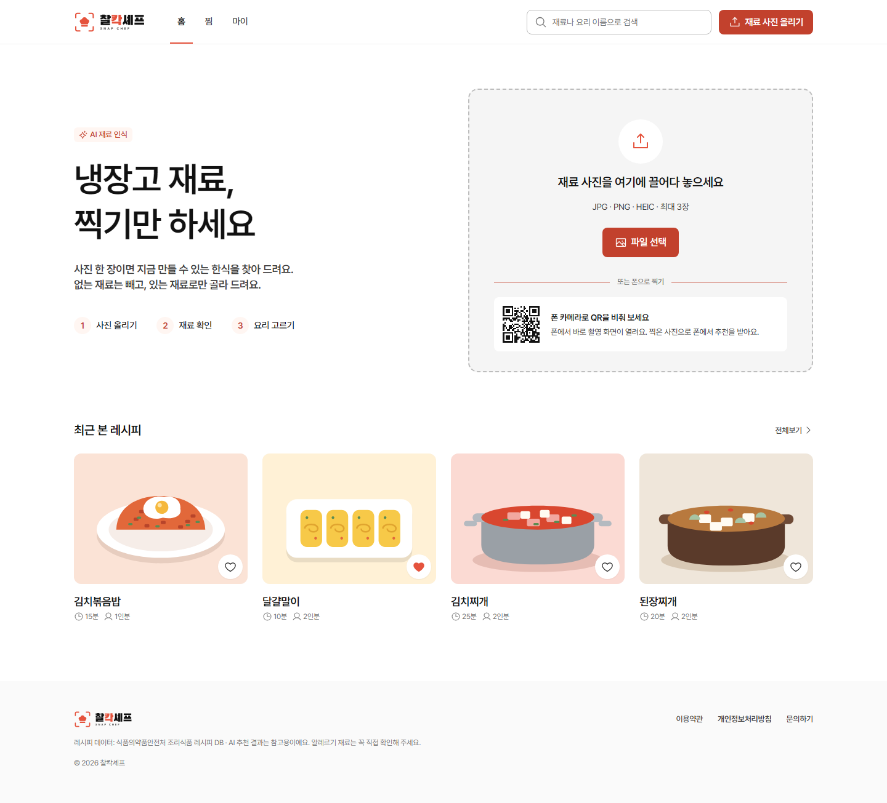

<p align="center">
  
</p>

<h3 align="center">냉장고 재료, 찍기만 하세요</h3>
<p align="center">사진 한 장으로 지금 만들 수 있는 한식을 찾아 주는 웹앱</p>

<p align="center">
  
  
  
  
</p>
<p align="center"></p>

## 무엇을 하나요

1. **사진 올리기**: 냉장고 재료를 찍거나(웹 카메라) 앨범·끌어다 놓기로 올려요.
2. **재료 확인**: AI(Gemini)가 찾은 재료를 확인하고, 확신이 낮은 재료는 "이것도 있나요?"로 물어봐요.
3. **요리 고르기**: 내 재료와 많이 겹치는 레시피부터, 부족한 재료와 함께 보여 줘요.
4. **조리 모드**: 단계별 큰 글씨, 단계 타이머(알림음·진동), 화면 꺼짐 방지, 키보드 ← →.

찜·최근 본 레시피·기본 양념·싫어하는 재료·테마(4종)는 로그인 없이 기기에 저장돼요.

## 기술 스택

| 영역 | 사용 기술 |
|---|---|
| 프론트엔드 | Vite 8, React 19 (+React Compiler), TypeScript, Tailwind CSS v4, TanStack Query, Zustand, React Router |
| 백엔드 | FastAPI (Vercel Python 서버리스), psycopg 3 |
| DB | Neon PostgreSQL (GIN·trigram 인덱스) |
| AI | Gemini (사진 → 재료, 구조화된 출력), EXAONE (레시피 데이터 보강, 오프라인 1회) |
| 데이터 | 식품의약품안전처 조리식품 레시피 DB (COOKRCP01) |
| 배포·CI | Vercel + Neon (무료, 카드 등록 없음), GitHub Actions |

설계 이유는 [docs/ARCHITECTURE.md](docs/ARCHITECTURE.md), 실행·배포 방법은 [docs/DEPLOY.md](docs/DEPLOY.md)에 정리했어요.

## 빠르게 실행

```bash
cp .env.example .env                 # 키 없이도 모의 인식(VISION_MOCK=1)으로 전체 흐름 확인
docker compose up -d                 # 로컬 PostgreSQL
python -m venv backend/.venv && backend/.venv/Scripts/pip install -r backend/requirements-dev.txt
backend/.venv/Scripts/python scripts/data/seed_db.py data/fixtures/recipes.sample.json
(cd backend && .venv/Scripts/python -m uvicorn main:app --reload --port 8000)
(cd frontend && npm ci && npm run dev)   # http://localhost:5173
```

## 폴더 구조

```
frontend/   Vite + React 앱 (features/ 화면별, components/ 디자인 시스템, stores/ Zustand, api/ 쿼리)
backend/    FastAPI 앱 (routers, services/matcher.py 일치도, repositories SQL, llm/gemini.py)
db/         DB 스키마
scripts/    데이터 수집·정리·LLM 보강·DB 적재
data/       샘플 레시피, 파이프라인 결과(recipes.json)
docs/       아키텍처·배포 문서
```

## 데이터 출처

레시피 데이터: 식품의약품안전처 식품안전나라 조리식품 레시피 DB. AI 추천 결과는 참고용이에요. 알레르기 재료는 꼭 직접 확인해 주세요.
